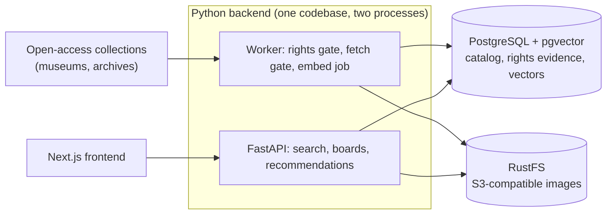

# OpenCanvas

[](https://github.com/justinleski/cc0/actions/workflows/check.yml)

A platform to browse and discover works that are copyright free and and can be modified (CC0) to be used on social media, websites, and videos. Runs locally, next steps are to to deploy to the cloud.

<!-- TODO: add a screenshot of the catalog and a board here -->

## What it does

- **Hybrid search:** natural-language queries ("misty blue coastal paintings") fused with exact
  metadata filters (creator, location, year).
- **Private boards:** pin, organize, and sign in locally to keep boards private.
- **Board-aware recommendations:** "more like this board" computed from the images pinned to it.
- **Auditable provenance:** i.e. every image carries its source URL and the rights evidence that got it in this collection. Anything not explicitly CC0 is never downloaded.

## Architecture



It is a feature-layered modular monolith. Postgres with pgvector is the
[single store for relational data, text search, and vectors](docs/decisions/0002-postgres-pgvector.md),
and image bytes live in [S3-compatible object storage](docs/decisions/0001-object-storage.md).
The API and worker use [separate least-privilege database logins](docs/decisions/0003-database-roles.md),
and code is [organized by feature rather than by technical layer](docs/decisions/0005-feature-based-layered-architecture.md).

## Key design choices

- **Rights-first ingestion:** image bytes are fetched only after CC0 evidence is recorded, and
  refused records are kept as a metadata-only negative cache. See [ingestion](docs/systems/ingestion.md).
- **Hybrid ranking:** lexical and vector results fused with reciprocal rank fusion, with
  quoted-phrase handling. See [search](docs/systems/search.md).
- **Stateless recommendations:** a board's profile is recomputed from its pins on every request,
  so there is no cache to invalidate. See [recommendations](docs/systems/recommendations.md).
- **Private boards:** signed local tokens and owner-scoped routes. See [boards](docs/systems/boards.md).
- **Measured, not guessed:** a versioned 1,000-image evaluation catalog for benchmarking
  retrieval. See [evaluation](docs/evaluation.md) and the [Met catalog](docs/met-evaluation-catalog.md).

**Stack:** Python 3.12, FastAPI, PostgreSQL + pgvector, OpenCLIP (optional; a deterministic fake
is the default), RustFS, Next.js, TypeScript, Docker Compose.

## Quickstart

Requires Docker Compose and `openssl`.

```bash
cp -n .env.example .env
grep -q '^CURSOR_SIGNING_KEY=' .env || printf 'CURSOR_SIGNING_KEY=%s\n' "$(openssl rand -hex 32)" >> .env
./scripts/start.sh
```

Open http://127.0.0.1:3000. Swagger docs are at http://127.0.0.1:8000/docs and readiness at
http://127.0.0.1:8000/api/v1/ready. Load the recorded Met fixtures (no network needed):

```bash
docker compose run --rm --no-deps api python -m app.worker ingest
```

This exits 1 by design: it stores 10 eligible assets and dead-letters 3 refused fixtures.
`docker compose stop` preserves data. For hot reload, host processes, and configuration, see
[local development](docs/local-development.md). Run `./scripts/check.sh` for the full acceptance
check ([test commands](docs/lint-test.md)).

## Documentation

| | |
|---|---|
| [Documentation index](docs/README.md) | Every system doc and ADR |
| [MVP spec](docs/mvp-spec.md) | Scope, data model, milestones |
| [Local development](docs/local-development.md) | Compose, host workflow, configuration |
| [Frontend walkthrough](frontend/README.md) | Catalog, boards, sign-in |

## Status

Milestones M0–M3 are done (infrastructure, ingestion with rights evidence, hybrid search, frontend
with private boards), and the M4 recommendation baseline is in place. Board export and
complement ranking are next ([why complement is hard](docs/systems/recommendations.md#complement-is-an-open-problem)).
