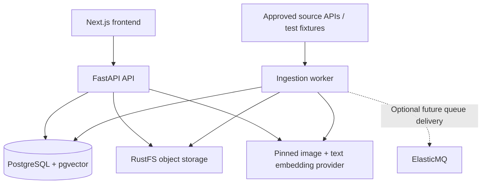

# CC0 Visual Boards — MVP System Design and Cursor Handoff

> **Status:** Implementation specification (2026-10-09)  
> **Primary goal:** Build a working, low-cost, locally testable **CC0-only**, Pinterest-inspired creative discovery application with board-aware visual recommendations.  
> **Target load:** At most ~10 monthly active users initially, with a pilot catalog of 100–500 verified images and a path to ~10,000.  
> **Cloud target:** AWS, **after** the local MVP works.  
> **Cost goal:** Roughly USD $20–30/month at low usage when deployed on a small single EC2 instance, excluding unusual ingestion, model, or transfer spikes. Not a guarantee or hard cap.

## Instructions to Cursor

Treat this document as the source of truth. **Implement only sections marked `MVP` unless explicitly asked to work on later phases.** Do not scaffold every future AWS service in advance. Deliver working, testable vertical slices and explain any deviations. Before writing substantial code, inspect the repository and summarize existing files and decisions; do not overwrite user work. Prefer small, independently verifiable commits or milestones.

**Definition of done for each milestone:** executable code, migrations where applicable, tests, updated `.env.example`, and reproducible Docker-based instructions. Avoid placeholders presented as completed functionality. Never commit secrets or real API keys.

## 1. Product and scope

### User problem

Creators want to discover **CC0-only** artwork and photographs by **precise facts** (creator, location, era, title) and **subjective semantics** (mood, composition, atmosphere, stylistic similarities). They build visual boards, explore suggestions informed by the **whole board's aesthetic**, and export usable collections with provenance and rights information. Boards are the main product, not a generic saved-search feature.

### Product promises

1. A result marked **CC0 verified** has supporting evidence recorded from an authoritative source; model-generated labels never establish copyright status.
2. A search for a specific creator/location must use structured metadata and never silently substitute embedding guesses.
3. “More like this board” combines visual/semantic cohesion with **typed factual relationships** between works; “Complement this board” aims for complementary diversity, not near duplicates.
4. Every exported image is accompanied by its creator, original source URL, rights evidence, and ingestion/verification timestamps.
5. **Only eligible, verified CC0 image bytes** are downloaded and stored in object storage, **not** as binary blobs in PostgreSQL. For non-CC0/unknown source discoveries, retain minimal negative-cache metadata only, with **no image bytes, thumbnails, or image embeddings**.

### Important legal/product distinction

- This is a **CC0-only platform**, not a general public-domain/open-license index. Treat `CC0`, `PUBLIC_DOMAIN_MARK`, `OTHER_OPEN`, `UNKNOWN`, and `REJECTED` as distinct *internal discovery classifications*. **Do not treat ordinary public-domain, CC BY, or other Creative Commons images as eligible CC0.**
- The public search corpus is strictly `CC0` **and** `VERIFIED`. If source-specific license evidence is ambiguous, **do not download the image**; cache its identifying metadata and revisit only if appropriate.
- Negative caching: retain source provider, external ID, canonical URL, observed rights status, evidence URL/short statement, checked-at time and next-recheck time for non-CC0/unknown records. Do not store their original or thumbnail bytes, derived image features, or embeddings. Retain only the minimum metadata necessary to prevent repeated work; revalidate periodically because upstream rights declarations can change.
- An index such as Openverse is useful for discovery but does not independently guarantee rights correctness. Where possible verify against the original source's item-level statement. Keep evidence and recheck dates; provide a takedown/suppression process.
- CC0 status does not establish model-generated factual accuracy, privacy/personality rights, trademark clearance, or permission under a provider's API/downloading terms. Do not claim absolute legal certainty.

### MVP user stories

1. Browse a grid of approved images, open an asset detail page, and visit its original source.
2. Search with a natural-language prompt such as “misty blue coastal paintings” and filter by exact creator, location, year range, or style tag.
3. Create a private **board**, pin/unpin/reorder images, and add a description/notes.
4. Open a board and explore **More Like This Board** (coherent) or **Complement This Board** (fits aesthetically but avoids repetition); also explore images related to an individual pin.
5. Export a board as a ZIP containing downloaded CC0 images plus `manifest.json` and `attribution.csv`.
6. An operator can ingest a configured source's records with controlled request rates, inspect verified CC0 rights and metadata-only negative-cache records, and approve/reject candidates.

### Explicitly outside MVP

- Scrapling/web crawling of arbitrary sites, browser-based scraping, user-uploaded third-party content.
- Social feeds, user collaboration, AI-generated images, payment systems, public APIs, commercial licensing guarantees.
- Neo4j/graph databases, OpenSearch, Redis, Kubernetes, multiple availability zones, microservice sprawl.
- Generative VLM scene graphs, exhaustive spatial relation extraction, learned personalization/ranking, and fully automatic AI-generated boards.
- Automatic full-corpus recrawls without a source-specific request budget.

## 2. Architecture decisions

| Area | MVP choice | Why | Future option / trigger |
|---|---|---|---|
| Backend | **Python 3.12+ / FastAPI (recommended MVP choice)** | Simplest end-to-end integration with Python image ingestion, OpenCLIP and testing; no separate language runtime | Spring Boot API + Python embedding/ingestion worker if Java proficiency becomes a primary objective; see decision below |
| Frontend | Next.js + TypeScript | Search-centric image UI and deployable static frontend where feasible | SSR only if needed |
| Database | PostgreSQL + `pgvector` | Structured relational data, text search, vector search, boards in one store | Managed RDS as operations or availability needs grow |
| Image storage | S3-compatible object-store adapter; RustFS locally, S3 on AWS | Same logical API in both environments | Dedicated image transformation service if necessary |
| Embeddings | Explicit `EmbeddingProvider` interface; pinned OpenCLIP locally; optional Titan Multimodal on Bedrock in AWS | Offline local image/text encoding and predictable provider switch | Benchmark quality/cost models; **full re-embedding on model change** |
| Workers | One Python ingestion/processing worker (separate local process/container) | Runs asynchronously without full orchestration | SQS-backed workers / Lambda / Fargate |
| Rate limiting | One worker + explicit source-specific spacing and 429 retry | Enforces provider rules instead of relying on concurrency limits | Distributed token bucket if multiple replicas exist |
| Authentication | Local development auth adapter and a production OIDC/JWT adapter | Test user ownership locally without AWS dependency | AWS Cognito user pool in cloud |
| Board export | Background ZIP generation to object storage | Keeps requests short; bundles provenance | Dedicated scalable export workers |
| Hosting | Local Docker Compose first; small EC2 instance + S3 + CloudFront later | Low idle cost | Move DB to RDS; separate compute, private networking |

**Architecture principle:** storage, queue, authentication, and embeddings must be behind small interfaces, not spread throughout business logic. Avoid building a generic plugin framework; use straightforward dependency injection and environment configuration.

### Backend framework decision: FastAPI vs. Spring Boot

**Default decision for Cursor: FastAPI for the API and Python for ingestion/embeddings. Do not create a Spring Boot service in the MVP unless the owner explicitly overrides this decision.** Reasons: this is a 10-user image/ML-heavy app, Python already owns download/image/model libraries, and one backend language shortens feedback loops and Docker/deployment complexity. Neither framework automatically solves S3/Postgres atomicity, idempotency or rate limiting; those are architecture/application concerns.

| Criterion | FastAPI + Python | Spring Boot + Java |
|---|---|---|
| Image preprocessing/OpenCLIP | Direct Python library access; simplest | Would typically call a separate Python worker/service |
| Typed HTTP services | Pydantic, type hints, OpenAPI | Strong static typing, records/DTOs, mature validation and Spring ecosystem |
| Relational persistence | SQLAlchemy/Alembic or psycopg | Spring Data JDBC/JPA, Flyway/Liquibase, JDBC tooling |
| Operational footprint | One language/runtime for API and worker | JVM plus Python sidecar/worker if local model processing is retained |
| Concurrency | Async I/O is useful; CPU inference must run outside event loop | Strong threading/async options; CPU inference still belongs outside request thread |
| Personal learning signal | Python AI infrastructure and data pipelines | More deliberate Java/Spring backend and enterprise-systems practice |

**Credible alternative:** Spring Boot (Java 21) handles user auth, REST, boards, PostgreSQL and exports; a **separate Python worker** handles API ingestion, image processing and embeddings. Both communicate via durable jobs/queue or a narrow HTTP contract. This is valid if learning Java/distributed boundaries is more important than shortest MVP delivery, but creates more tests, Docker services, schema/contract versioning and memory usage. Keep the same database/rights/board design. Do **not** use Java merely because a microservice architecture looks impressive.

### Local topology



`ElasticMQ` is **optional during the first vertical slice**. Start with a durable PostgreSQL-backed job table and an independently running worker; add SQS-compatible queue delivery after core ingestion and idempotency are proven. Do not build two competing authoritative job stores: PostgreSQL holds job state, while SQS/ElasticMQ (if enabled) is a wake-up/delivery mechanism.

### Low-cost AWS topology (after local acceptance)

- One appropriately sized ARM EC2 instance running containers for FastAPI, PostgreSQL, and a bounded worker; reverse proxy with HTTPS. Database listens only on localhost/private Docker networking. Instance profile provides temporary AWS credentials.
- S3 stores originals, thumbnails, and temporary exports in separate prefixes/buckets with appropriate permissions; CloudFront serves approved images from private S3 via Origin Access Control.
- Cognito handles production user identities. The API verifies tokens and enforces board ownership.
- Bedrock Titan Multimodal may generate both image and text embeddings on demand. Maintain a model version and use **exactly one compatible image/text vector space** within each active index. Switching from local OpenCLIP to Titan requires a full image re-embedding/index rebuild, not just an environment variable change. On a ~2 GiB server, self-hosting OpenCLIP alongside PostgreSQL and the API may be memory-tight; benchmark or use Bedrock to keep model RAM off EC2.
- Optional SQS/EventBridge can replace local scheduling/job wakeups without rewriting the ingestion core.
- Do **not** provision RDS, NAT Gateway, public load balancer, OpenSearch, or ECS for the first ten users by default. Their fixed costs are not justified yet.
- Keep the production DB backed up to separate durable storage; document restoration. A single instance is a deliberate single point of failure.

## 3. Repository layout (suggested)

```text
.
├── README.md
├── docs/
│   ├── architecture.md
│   ├── local-development.md
│   ├── evaluation.md
│   └── aws-deployment.md             # future phase
├── docker-compose.yml
├── docker-compose.test.yml           # if needed for isolated integration tests
├── .env.example
├── frontend/
│   └── ...                            # Next.js app
├── backend/
│   ├── pyproject.toml
│   ├── alembic.ini
│   ├── migrations/
│   ├── app/
│   │   ├── api/                      # FastAPI routes and request/response schemas
│   │   ├── core/                     # config and auth
│   │   ├── db/                       # models, migrations, repositories
│   │   ├── domain/                   # catalog, rights, boards, cohesion/search logic
│   │   ├── integrations/             # provider APIs, S3/RustFS, embeddings, queue
│   │   ├── workers/                  # ingestion, thumbnail, export jobs
│   │   └── main.py
│   ├── tests/
│   │   ├── unit/
│   │   ├── integration/
│   │   ├── fixtures/
│   │   └── e2e/
│   └── scripts/                      # seed, reindex, smoke test
└── infra/
    └── aws/                          # IaC only after local MVP
```

Do not enforce this exact tree if an existing repository has a coherent alternative. Keep boundaries explicit.

## 4. Core data model (MVP)

Use Alembic migrations and database constraints, not only Pydantic validation. Store UTC timestamps. Use UUID primary keys unless a reason to choose another type is documented.

| Table | Minimum columns / invariants |
|---|---|
| `users` | `id`, `auth_subject` unique, `created_at` |
| `providers` | `id`, `name`, `base_url`, `enabled`, `rate_limit_rps`, `policy_url`, `last_cursor` |
| `creators` | `id`, `name`, `aliases` JSONB, `external_ids` JSONB |
| `source_records` | `id`, `provider_id`, `external_id`, `landing_url`, `original_url` (URL string only), minimal `raw_metadata` JSONB, `rights_classification`, `eligibility_status`, `last_rights_checked_at`, `next_recheck_at`, `first_seen_at`, `last_fetched_at`; unique `(provider_id, external_id)`. **This is the metadata-only negative cache for non-CC0/unknown records; no image objects required.** |
| `assets` | `id`, `source_record_id`, `creator_id` nullable, `title`, `description`, `location_label`, `created_year_start/end`, `style_tags` text[], `original_key`, `thumbnail_key`, `sha256`, `mime_type`, `width`, `height`, `ingested_at`, `status`; unique `source_record_id` |
| `rights_evidence` | `id`, `source_record_id`, `asset_id` nullable, `rights_type`, `verification_status`, `evidence_url`, `raw_statement`, `verification_method`, `checked_at`, `reviewer_id` nullable; append-only verification history. Evidence attaches to `source_records` even when **no asset is ever created**. |
| `asset_embeddings` | `asset_id`, `model_key`, `model_version`, `dimensions`, `embedding vector(512)`, `generated_at`; unique `(asset_id, model_key, model_version)`. Insert-only. A wider model needs a new column. |
| `asset_relations` | `src_asset_id`, `dst_asset_id`, `type`, `origin` (`SOURCE`/`DERIVED`), `score` nullable, `model_version` nullable; unique typed edge identity |
| `boards` | `id`, `owner_user_id`, `name`, `description`, `created_at`, `updated_at`, `profile_version` nullable |
| `board_items` | `board_id`, `asset_id`, `position`, `notes`; unique `(board_id, asset_id)` |
| `jobs` | `id`, `kind`, `dedupe_key` unique, `state`, `attempt_count`, `max_attempts`, `next_run_at`, `payload` JSONB, `last_error`, `created_at`, `updated_at` |
| `exports` | `id`, `board_id`, `requested_by`, `state`, `object_key` nullable, `expires_at`, `created_at` |

**Two separate lifecycles:**

- **Discovery/negative cache (source record, no image bytes):** `DISCOVERED -> RIGHTS_CHECK -> ELIGIBLE_CC0 | NON_CC0_CACHED | UNKNOWN_CACHED`. Non-CC0/unknown statuses store only minimal metadata; once their `next_recheck_at` passes, a new metadata-only rights check may revise status. Do not create an `assets` row for these.
- **Verified CC0 asset:** after `ELIGIBLE_CC0` and evidence verification, `APPROVED -> PROCESSING -> READY`; it can later become `SUPPRESSED` if rights evidence is withdrawn or challenged. Only `READY` assets with latest valid `VERIFIED CC0` evidence appear in public search, board recommendations or exports. Suppression immediately excludes an asset from new responses/exports; quarantine or remove stored bytes under a documented policy.

**Relationship MVP types:** `SAME_CREATOR`, `SAME_COLLECTION`, `SAME_STYLE_TAG`, `SAME_LOCATION`, and `VISUALLY_SIMILAR`. Record whether each edge is source-backed or algorithmically inferred. Never display an inferred relationship as a verified historical fact.

**Indexes:** btree on creator, year, eligibility/status, `source_records.next_recheck_at`, boards' owner; GIN for text search/tags; pgvector index appropriate to corpus size and model dimensions (benchmark exact scan first; add HNSW when justified). Keep vector columns/indexes specific to compatible dimensions/models. `board_items` is the authoritative saved-pin set; compute a simple board embedding profile from saved asset vectors at read/update time before introducing dedicated profile tables.

## 5. Ingestion pipeline (MVP)

### Initial source policy

Start with **one** trustworthy API source with explicit rights evidence and stable identifiers; only add a second after completing the first adapter. The Met Open Access API and Openverse can inform source selection, but verify each source's current endpoint, API terms, rate limits, and whether the specific **digital image is explicitly CC0**. Ordinary public-domain status, even where commercial use is permitted, is not a substitute for an affirmative CC0 designation in this product. Openverse alone is not sufficient verification. A provider-specific allowlist must govern metadata requests and eligible image download hosts.

### Steps

1. **Discover:** Scheduled/manual source adapter obtains external IDs/metadata, obeying paging/cursors and configurable request budget.
2. **Deduplicate and negative-cache check:** `provider + external_id` upsert creates or updates `source_record`. Before refetching a known non-CC0/unknown record, check `next_recheck_at`. If not due, skip metadata fetch and **do not schedule image download**. Queue/fetch work idempotently using a stable dedupe key.
3. **Metadata validation:** Validate source IDs, metadata schema, original landing URL, provider/API terms, and known rights fields **without fetching image bytes**; normalize creators and provenance fields.
4. **Rights gate:** Check explicit item-level CC0 evidence before any image request. Store `rights_evidence` linked to `source_record`. Classify non-CC0/unknown discoveries as `NON_CC0_CACHED`/`UNKNOWN_CACHED` with reason, evidence, checked-at and recheck-after timestamps. **Stop processing here for all non-eligible items: no RustFS/S3 PUT, no thumbnails, no image embeddings, no public `assets` row.** An eligible record proceeds only after affirmative CC0 verification.
5. **Eligible CC0 download:** Only now validate/stream the image with maximum bytes, timeout, redirect limit, public-IP/host allowlist and content-type verification. Decode with bounded image processing; reject dangerous/unsupported files. Calculate SHA-256.
6. **Store:** Write original under an immutable/content-addressed key and generate thumbnail (e.g., max dimension ~512 px, WebP/JPEG). Save both to RustFS locally, and to S3 on AWS, with private access.
7. **Embed:** A separate `embed` job, enqueued in the same transaction that inserts the asset, reads the original already in object storage and writes one vector for the loaded provider identity. OpenCLIP's identity is `MODEL_KEY` and `MODEL_VERSION`. The fake provider's identity is `fake` / `deterministic-v1`. A failure retries that job only. It does not re-lease the download. The asset stays `STORED` and is not public.
8. **Publish:** The embed job inserts into `asset_embeddings` (a new model version is a new row) and sets the asset `READY`. Public search reads `ready_assets`: `READY` and the latest evidence row is verified CC0. A newer decision that is not verified CC0 sets `SUPPRESSED` in the same transaction as the evidence insert. `python -m app.worker reembed` queues assets missing the loaded identity and is safe to run again.
9. **Reconcile:** Scheduled repair detects jobs stuck in progress and orphaned objects. Because object store and PostgreSQL cannot share a transaction, workers must recover safely from partial success.

**Invariant test:** A source record labeled CC BY, public-domain mark, unknown or any non-CC0 type must never trigger an HTTP GET of the image file, any object-storage write, thumbnail generation, or embedding invocation. Repeated discovery before `next_recheck_at` must short-circuit using metadata cache; a subsequent genuine rights change to explicitly verified CC0 can make it eligible. Preserve links and brief evidence text, **not** copyrighted file bytes or data URI previews.

### Rate-limit and retry requirements

- Set a conservative provider-specific requests-per-second budget and concurrency limit; never target the provider's theoretical maximum by default.
- Handle `429` using `Retry-After` when provided, otherwise exponential backoff with jitter; retry transient 5xx/timeouts, but not permanent 4xx.
- Cap attempts; preserve error metadata and surface failed jobs to the operator. If SQS is introduced, use an actual DLQ and test redrive behavior.
- Crash/restart, repeated record, and duplicate queue delivery **must not create duplicate asset rows or unnecessary re-downloads/re-embeddings**.
- For a single local worker, time-spacing is sufficient. If worker replicas are introduced, move to a shared quota/token bucket before scaling out.
- Keep network ingestion disabled in normal unit tests; use recorded sanitized JSON and fake image bytes.

## 6. Embedding pipeline — concrete MVP implementation

The earlier architecture named a provider but did not describe it. **Implement an explicit multimodal embedding contract**:

```python
class EmbeddingProvider(Protocol):
    model_key: str
    model_version: str
    dimensions: int

    def embed_image(self, image_bytes: bytes) -> list[float]: ...
    def embed_text(self, text: str) -> list[float]: ...
```

### Local production-like provider: OpenCLIP

- Use the open-source `open_clip_torch` library with one ViT-B checkpoint. The column is `vector(512)`. `MODEL_KEY` and `MODEL_VERSION` choose the checkpoint; `unpinned` refuses to download weights. A manual `python -m app.embeddings` checks width and that a related image/text pair outranks an unrelated one, without comparing bit-exact floats. CI uses the deterministic fake provider. Candidate weights remain `ViT-B-32` / `laion2b_s34b_b79k` until one is chosen. A 768-d model needs a new column.
- `embed_image`: read **only a verified CC0 original**, decode with Pillow, run the exact model-specific preprocessing, run `encode_image` under inference/no-grad mode, convert to float32 and L2-normalize.
- `embed_text`: tokenize the user's search string with that same model's tokenizer, run `encode_text`, convert to float32 and L2-normalize. Image and text embeddings now live in a **shared compatible space**.
- **On ingestion:** one vector is computed for each newly verified CC0 asset and stored in `asset_embeddings` with a model key, weights revision, dimensions and timestamp. A checksum match and existing current-model embedding skips redundant inference.
- **On search:** compute **one text embedding per query**, not one image embedding for each returned result. PostgreSQL pgvector performs a cosine-distance nearest-neighbor search over stored current-model image vectors. For image-to-image suggestions, use the saved candidate image's existing vector.
- The worker can load and reuse one model instance for a batch. Do not load model weights per image. CPU mode is sufficient for the small local fixture catalog. CI and the default local run use the deterministic fake provider. Its vectors are exact and shared between image and text for tests; they are not a semantic model. A chosen OpenCLIP checkpoint is the manual `python -m app.embeddings` smoke and is not selected yet.
- Keep the actual model weights outside the Git repo and document a cache/preload step for offline repeatability. Validate that the selected pretrained weights and data/model licenses are suitable for the intended use.

### Cloud option: Bedrock Titan Multimodal Embeddings

- An AWS provider can call `bedrock:InvokeModel` using IAM temporary credentials and Titan Multimodal's image/text request forms. Configure the **same output dimension** for both operations (Titan supports 256/384/1024, model/region permitting). Store model ID, dimension and generation version per vector.
- Do not use **Titan Text Embeddings** alone to encode queries while OpenCLIP/Titan Multimodal encoded the images; unrelated embedding spaces cannot be compared meaningfully.
- **OpenCLIP-to-Titan migration is a full data migration:** encode every approved original image with Titan, write a separate model/version index, compare sample retrieval quality, atomically switch the active model pointer, and retire prior vectors only after validation. Retain original images to enable re-embedding. Do not mingle OpenCLIP vectors and Titan vectors in one distance ranking.
- For the lowest-cost AWS setup, Bedrock avoids the RAM/CPU burden of a persistent local model; calculate actual image ingestion and per-query charges before choosing it. Local development remains fully functional with OpenCLIP or fake embeddings, with no AWS account.

### Vector storage contract and tests

- The migration defines `vector(512)`. Different dimensionality requires a new column, not silent truncation or padding. Rows are insert-only, so an older checkpoint can stay in the table and the environment pointer can point search back at it.
- L2 normalization is covered by the fake provider's unit test. Search and embed store the provider identity: fake rows use `fake` / `deterministic-v1`, and OpenCLIP rows use `MODEL_KEY` / `MODEL_VERSION`. The manual OpenCLIP command checks that a related pair outranks an unrelated one. CI does not load a real model, and no checkpoint has been selected.
- `python -m app.worker reembed` is restart-safe. It writes new rows for the active checkpoint and does not remove the previous ones. Search reads only the configured model key and version, so the previous ranking stays available until that pointer changes.

## 7. Search and board recommendations (MVP)

### Query modes

1. **Exact filters:** user-selected creator ID, location, year interval, and license status are applied in SQL before final ranking. Do not infer factual matches from embeddings.
2. **Text retrieval:** PostgreSQL full-text retrieval over title, description, creator name and tags; include fuzzy matching only with explicit expectations.
3. **Semantic retrieval:** Generate a text query embedding using the same compatible model family/version as indexed image vectors, then retrieve nearest neighbors by cosine distance.
4. **Hybrid ranking:** Reciprocal rank fusion with `k = 60` combines the lexical rank and the cosine rank. Do not add the raw scores. A balanced `"phrase"` in `q` is a required unstemmed match, applied before fusion; a quotes-only query does not call the text encoder. An unpaired quote is stripped, and the response field `applied_query` is the text actually searched. Names and aliases are not stemmed. Titles, tags, and descriptions also have an English-stemmed vector, and `ts_rank_cd` orders the lexical list. Creator trigram similarity is a "did you mean" suggestion, not a change to asset ranking.
5. **Related individual images:** Exact cosine order of the active model's stored vectors. No HNSW at this corpus size. Creator, location, and overlapping style tags are returned as reasons computed in the query. Persisted `asset_relations` edges are deferred.
6. **Board-level coherence:** When a board has saved images, form an L2-normalized centroid from their **compatible image embeddings**. The simplest MVP uses it to retrieve additional CC0 candidates with matching mood/style. Exact creator/location filters remain independent. Use the board's saved asset IDs to exclude repeats. Do not recompute every image vector when the board changes—only recompute the lightweight board profile.
7. **Complement this board:** Take a coherent candidate pool but diversify it against *all* saved images (e.g. maximal marginal relevance/MMR using candidate-to-saved cosine similarity and optional shared metadata). “Complement” means stylistically compatible yet not a near duplicate; it is not a guarantee of human aesthetic judgment.
8. **Feedback:** Saving/removing pins updates recommendations for the current board. MVP permits a board to be empty (show search/discovery instead); a single-pin board falls back to that image's embedding. If the board contains multiple distinct styles, a single centroid may blur them—multi-cluster board profiles are deliberately future work.

### Search API contract

- `GET /api/v1/assets?q=&creator_id=&location=&year_from=&year_to=&limit=&cursor=` — paginated approved results.
- `GET /api/v1/assets/{id}` — approved asset detail with provenance and rights summary.
- `GET /api/v1/assets/{id}/related?limit=12` — related approved assets, optional `reason` field.
- `GET /api/v1/creators?query=` — creator lookups for exact filter UI.
- `GET /api/v1/boards/{id}/recommendations?mode=cohesive|complement&limit=20` — authorized board-aware suggestions based on current saved pins; no image outside verified CC0 eligibility.
- `GET /api/v1/health` — application liveness; `GET /api/v1/ready` — DB/dependency readiness.

Use stable ordering/cursors. Limit responses and protect expensive full-corpus queries. If `q` is absent, use newest/editorially chosen assets rather than computing embeddings.

### Search evaluation

Seed 50–100 manually inspected queries across moods, styles, creator names, subjects and composition. Record graded relevance judgments in a versioned dataset. Compare keyword-only, vector-only and hybrid Recall@10/NDCG@10. Add a small set of curated example boards and human judgments of **cohesive vs complementary** candidate sets; compare against single-pin nearest-neighbor recommendations. Keep model ID, corpus snapshot, filters and query set fixed for comparisons. Record P50/P95 latency and index size at ~1K and ~10K assets. Document failure cases: relation/order confusion, obscure artists, multimodal boards, multilingual queries and missing metadata.

## 8. Boards, authentication and export (MVP)

- Development: deterministic local accounts/JWTs, explicitly enabled only with `APP_ENV=local|test`. Production: JWT verification against configured OIDC issuer/audience/JWKS, Cognito-compatible.
- Every board mutation, board-aware recommendation request and export checks the authenticated subject against `boards.owner_user_id`; a guessed board UUID never bypasses ownership.
- CRUD: `POST /api/v1/boards`, `GET /api/v1/boards`, `GET /api/v1/boards/{id}`, `PATCH /api/v1/boards/{id}`, `DELETE /api/v1/boards/{id}`; pin add/remove/reorder operations under `/api/v1/boards/{id}/items`.
- Board UI is the main workflow: search/find a seed image → add to board → see *More Like This Board* and *Complement This Board* → refine the board → export. Boards should feel Pinterest-like without copying its brand/assets.
- Export: `POST /api/v1/boards/{id}/exports` returns `202 Accepted` and an export ID. `GET /api/v1/exports/{id}` reports status and a short-lived download URL if ready.
- ZIP includes originals when available/approved; `manifest.json` and `attribution.csv` have asset ID, filename, title, creator, source landing URL, original URI, rights type, license/evidence URL, fetched timestamp, verified timestamp, and export timestamp. Preserve stable image-to-metadata mapping.
- Snapshots: resolve asset versions/board items at job start; if an asset is suppressed before packaging, **exclude it or fail safely**. Do not export unverified assets. No non-CC0 negative-cache item may be added to a board.
- Store exports in a private prefix, with short-lived download permission and lifecycle cleanup. ZIP generation and failures must be restart-safe.

## 9. Local development and Docker (MVP)

### Dependencies

- Docker Engine/Desktop with Compose V2 (Windows users may run via WSL2).
- Python, Node.js and package manager versions pinned in the repository.
- Local services: PostgreSQL with pgvector and RustFS. Optional ElasticMQ profile/compose service once queues are implemented.
- The default local embedding provider is the deterministic fake. OpenCLIP is optional: `MODEL_VERSION=unpinned` refuses to download weights, and a checkpoint is chosen by the manual smoke rather than by CI. CPU inference is acceptable for tiny fixture sets; GPU optional. Download model weights separately, cache them, and keep weights out of version control. The same preprocessing/tokenizer and model must encode images and queries.

### Compose expectations

1. `docker compose up -d postgres rustfs rustfs-init` starts durable dev infrastructure, health checks, named volumes and local-only exposed ports. `rustfs-init` exits after the bucket exists.
2. `docker compose --profile queue up -d` optionally enables ElasticMQ for SQS-equivalent tests.
3. API and worker can be run either as containers or on the host with hot reload. Use service DNS names inside Docker (`postgres`, `rustfs`) rather than `localhost`; host-run processes use forwarded local ports.
4. The `cc0` bucket is created automatically by an idempotent `rustfs-init` container using path-style S3 calls. Credentials are dummy local values from `.env`, never real cloud secrets. RustFS is the local development object store. MinIO is not a dependency; its community edition was discontinued.
5. The DB migration command is explicit; startup should not silently destroy or recreate schemas.
6. `.env.example` documents `DATABASE_URL`, `OBJECT_STORE_ENDPOINT`, bucket, `STORAGE_PROVIDER`, `EMBEDDING_PROVIDER`, `MODEL_KEY`, `MODEL_VERSION`, `MODEL_DIMENSIONS`, weight cache path, source allowlist, source rate limits, negative-cache recheck policy, `APP_ENV`, and local auth settings.
7. README includes copy/paste commands to build/start, run migrations, seed fixtures, ingest 10 sample CC0 records plus non-CC0 negative-cache fixtures, generate local embeddings, test search and board recommendations, create a board, export it, run tests, and stop services **without deleting named volumes**.

### Useful local choices

- Use `pgvector/pgvector` as Postgres base image and explicitly `CREATE EXTENSION vector` in migration/setup.
- Use RustFS as the local S3-compatible store; test the code against real S3 later because exact semantics/signing can differ. Configure clients for path-style addressing.
- Use ElasticMQ for SQS semantics without a local paid AWS emulator. Additional LocalStack tooling is optional, **not required**.
- Prefer image URLs and source records from test fixtures by default so CI requires no network/API keys.

### Test tiers

| Test tier | Tool/approach | Must prove |
|---|---|---|
| Unit | `pytest`, mocks/fakes | Strict CC0 gate, negative-cache TTL, parsers, score fusion, board cohesion/diversity, retry decisions, owner authorization |
| DB integration | Real Compose Postgres/pgvector | Migrations, constraints, filters, vector operators, transaction rollback |
| Storage integration | RustFS + test bucket | Object PUT/GET, thumbnails, checksums, export files, object-key idempotency |
| Queue integration | ElasticMQ (when enabled) | Duplicates, visibility timeout, retries, poison message routing |
| HTTP integration | FastAPI test client + Compose DB | Pagination, auth, board CRUD/recommendations, readiness/error responses |
| Pipeline E2E | Fake source HTTP server + real local dependencies | CC0 discover -> verify -> image -> thumbnail -> embed -> board suggestions -> export; non-CC0 stops at metadata-only cache |
| Failure injection | Kill worker, inject 429/500/timeouts, corrupt input | Recovery, no duplicates, bounded retries, no publication before completion |
| Relevance/performance | Reproducible fixture corpora, `k6`/Locust optionally | Search quality and P95 latency under specified dataset sizes |

**Minimum CI:** lint/type-check, unit tests, DB migrations and integration tests. Avoid network access in CI except dependency installation; use reproducible image/data fixtures. Retain test logs only when needed for debugging.

## 10. Security and IAM (MVP and cloud handoff)

### Local

- All local credentials are non-production and ignored by Git. Never expose PostgreSQL or RustFS console ports to the public internet.
- Parse and sanitize untrusted source data. Enforce request timeout, redirect limits, download size limits, image decoder safety checks, source host allowlists and rejection of private/reserved IP targets to reduce SSRF risk.
- Avoid logging user tokens, API keys, signed URLs, or large raw source payloads. Log job IDs and safe metadata. Negative cache records must be metadata-only and should exclude base64 images/data URI previews even if included in an upstream API payload.
- Validate permissions at API/service boundary; test cross-user denial (403/404) and export authorization.

### First AWS deployment

- Attach a scoped **EC2 instance role** for S3 and Bedrock access; no static AWS access keys on disk. Separate deployment role with least privilege.
- Keep S3 buckets private; CloudFront Origin Access Control reads only published image prefixes; export objects require short-lived signed access. Deny insecure transport and block public S3 access.
- Scope identity tokens and application-level ownership independently of IAM. HTTPS only; restrict host security groups; patch the instance.
- DB lives on an internal container network, without public port exposure. Use backups/restoration drills and secure production secrets storage.
- Enable CloudTrail, CloudWatch metrics/log retention, AWS Budgets and cost anomaly alerts. Budgets are alerts, not a hard billing cap.
- Before provisioning, estimate AWS costs for the actual region and review whether the account qualifies for credits/free-tier allowances.

### When splitting into multiple AWS services later

Use separate roles for API, ingestion, processing and export. API may read catalog and enqueue exports but not modify ingestion evidence. Ingestion may read approved provider secrets and write staging objects, not user boards. Export may read approved originals and write private exports, not change source records. Move RDS to private subnets and avoid accidentally adding an always-on NAT Gateway without modeling its cost.

## 11. Observability and operational budgets

MVP logs should be structured and include request/job/correlation IDs. Track `assets_ready`, `source_records_non_cc0_cached`, `source_records_unknown_cached`, negative-cache hits, verified-CC0 admission rate, ingestion success/error/429 counts, jobs by state, retries, deduplications, **non-CC0 image download attempts (must remain zero)**, bytes downloaded, embeddings generated by model version, board recommendation P95, export failures, and S3 usage. Use a simple operator CLI/admin-only endpoint, not a full dashboard initially.

**Default protective limits (configurable, not provider claims):** 100 initial records per manual ingestion batch, one in-flight source HTTP request per provider, ≤10 MB maximum eligible CC0 source image in pilot, ≤3 retries with bounded exponential backoff plus jitter, board export limited to 100 images until benchmarked, no automatic crawling. Exact size limits can change based on vetted sources.

## 12. Implementation order and acceptance gates

### Milestone M0 — Repo foundation and local infrastructure

- Initialize frontend/backend, Docker Compose PostgreSQL+pgvector+RustFS, `.env.example`, lint/test config, Alembic, README.
- **Accept when:** one command starts healthy local dependencies, migration succeeds on a clean DB, app health endpoint responds, integration test connects to pgvector and object store.

### Milestone M1 — Ingestion and provenance vertical slice

- One provider adapter, fixture source, normalized schema, source-record negative cache, rights gate, single bounded worker, **CC0-only** image download, hash, thumbnail, asset state machine.
- **Accept when:** 10 verified CC0 fixture assets ingest repeatably; non-CC0/unknown fixtures leave **no asset row and no image download or object/embedding writes** but retain minimal source/license metadata; cache avoids redundant checks before recheck time; a duplicate ingestion creates no second asset; failed mid-processing job can resume.

### Milestone M2 — Image embeddings and hybrid search

- Embedding adapter (deterministic fake provider, optional OpenCLIP loader), concrete image/text encoding, normalized vectors, dimension/model metadata, vector schema, exact metadata filters, lexical search, semantic query, fusion, related-image endpoint, restartable re-embedding CLI.
- **Accept when:** CI and the default local run use the fake provider; those vectors have the column width and the shared image/text ranking the tests demonstrate; seeded queries return stable results; exact filters are respected; the stored model identity is the encoder that produced the vector; the similarity index can be rebuilt for that identity. A chosen OpenCLIP checkpoint is a manual smoke (`python -m app.embeddings`) and is not selected yet.

### Milestone M3 — Creator-facing UI and boards

- Pinterest-inspired image grid/detail, search/filter UI, related single images, local auth, private board CRUD, saved pins and ordering.
- **Accept when:** user can search, create a board, save/reorder pins and reload it; second user cannot read/write the first user's boards.

### Milestone M4 — Board-aware recommendations, exports and reliability

- Basic normalized board centroid, **More Like This Board** and **Complement This Board** ranking, candidate deduplication/diversification, background ZIP exports, full provenance manifest, failure/retry tests, E2E script, evaluation benchmark and README for local reproduction.
- **Accept when:** adding/removing pins changes authorized board recommendations; candidate list contains only verified CC0 assets and never repeats saved pins; recommendations can be compared with a single-pin similarity baseline; user exports only approved selected assets, source evidence remains attached, and repeated/failed jobs do not corrupt state.

**M4 status (2026-10-18)** — only criteria with passing evidence are listed as met;
see [reproducing M4](m4-reproduction.md) and the [checklist](m4-checklist.md).

| Criterion | Status | Evidence |
| --- | --- | --- |
| Exports contain only approved, selected assets; source and rights evidence stay attached | Met | `test_exports.py` (contents vs. catalog, manifest/CSV/hash checks), `scripts/m4_e2e.py` |
| Repeated, failed, interrupted, and duplicate export jobs do not corrupt state | Met | `test_exports.py` (retry, attempt exhaustion and redrive, upload interruption, stale claim, concurrent workers) |
| Rights suppression during packaging and before download is honoured | Met | `test_exports.py` (before packaging, during packaging, after publish) |
| Exports and recommendations are owner-scoped | Met | `test_exports.py`, `test_m4_e2e.py`, role-privilege tests |
| Export UI: progress, download, failure and retry states | Met at component level | `frontend/tests/board-export.test.tsx`; not exercised in a real browser |
| Pin changes change authorized recommendations; candidates are verified CC0 and never repeat pins; single-pin baseline comparison | Pending merge | Implemented and passing on `feat/recommendation-algo`; verified together with exports in a combined checkout, but not yet on `milestone/m4` |

### Milestone M5 — AWS pilot (only when requested)

- IaC/deployment scripts, EC2 instance role, private S3/CloudFront, Cognito, HTTPS, backups, alerts, smoke tests on 50 images.
- **Accept when:** deployed search/export works end to end, another user is unauthorized, objects are not publicly addressable via direct S3, a backup restore succeeds, and first-week spend is observable.

## 13. Future improvements — explicitly deferred

| Phase | Improvement | Trigger / value |
|---|---|---|
| F1 | Scrapling crawler on ECS Fargate | API catalog coverage becomes limiting; per-site robots/ToS and rate policies approved |
| F1 | SQS + separate independently scaled workers | Large batch processing blocks queries or jobs require horizontal scaling |
| F1 | RDS PostgreSQL and private VPC | Managed backups/uptime outweigh added fixed costs; EC2 DB is operational burden |
| F1 | Richer visual relation inference (subject-predicate-object) | User testing shows compositional searches are weak |
| F1 | Multi-cluster board embeddings and visual role suggestions | Board centroid fails on mixed aesthetics or users want specific complementary roles |
| F1 | Human curator verification dashboard | Evidence review becomes a bottleneck |
| F2 | OpenSearch / separate vector index | Proven SQL/vector performance bottleneck at larger corpus |
| F2 | Personalized related images and collaborative signals | Enough user behavior data exists to evaluate them responsibly |
| F2 | Redis caching/CDN transformation layer | Measured search or image-delivery hot spots |
| F2 | Multi-tenant SaaS, teams, billing | Actual adoption and explicit product demand |

Avoid adding these until measured need or a deliberate technical-learning milestone makes the extra complexity worthwhile.

## 14. Engineering tradeoffs to record publicly

Capture the following in `docs/architecture.md` as the product grows:

1. Why a single PostgreSQL+pgvector database is sufficient initially; exact vs approximate search benchmarks.
2. Why media bytes live in object storage; how checksums and reconciliation handle partially committed uploads.
3. Evidence-first CC0 pipeline and its false-positive/false-negative tradeoff.
4. Hybrid lexical/vector ranking evaluation against pure keyword and pure vector baselines.
5. Rate limiting, backpressure and bounded retries; why SQS at-least-once means idempotency is mandatory when introduced.
6. Local-to-AWS evolution: measured infrastructure cost vs throughput and operational complexity.
7. Board-aware cohesive/complementary retrieval vs individual-image nearest neighbors, with a small human-preference evaluation.
8. Strict CC0-only ingestion, metadata-only negative caching, evidence rechecks and the tradeoff between catalog size and legal confidence.
9. OpenCLIP vs Bedrock image/text embedding quality, cost, dimensions, and the cost of re-embedding after a model switch.

### Final instruction to Cursor

**Start with Milestone M0 only.** Show the proposed files, Compose services and verification commands, then implement M0 and run its acceptance tests. Ask before moving to M1. Do not deploy AWS resources or incur paid cloud charges without explicit approval.
