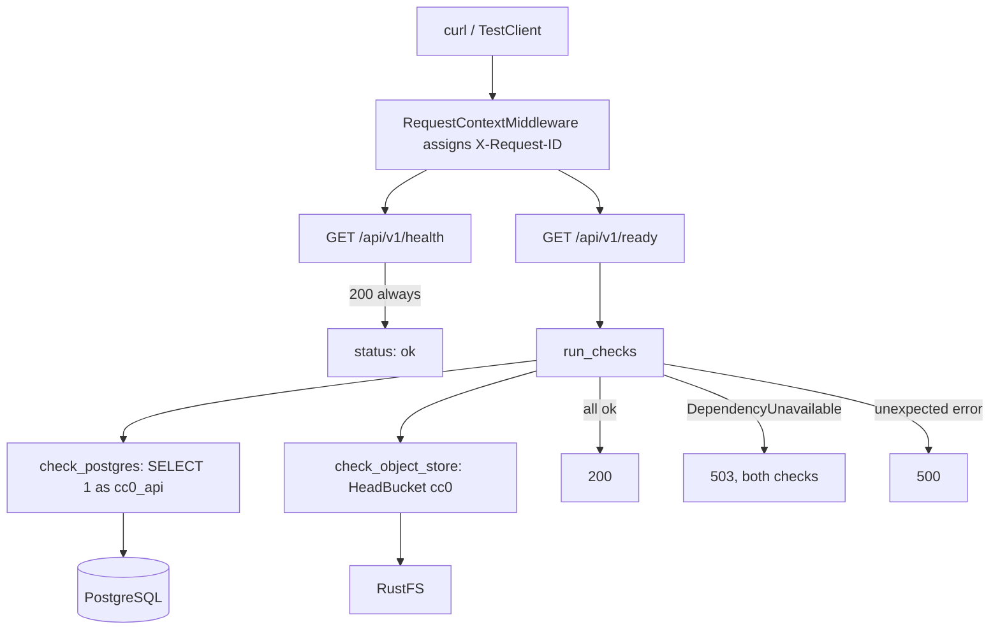

# API process

Status: Implemented (health and readiness only)
Owner: [backend/app/](../../backend/app/main.py)
Depends on: PostgreSQL, RustFS
Related: [storage.md](storage.md), [ADR-0003](../decisions/0003-database-roles.md), [ADR-0004](../decisions/0004-host-processes.md)

## Summary

A FastAPI application with two routes under `/api/v1`: a liveness check that
answers from the process alone, and a readiness check that proves Postgres and
the object store are both reachable with the credentials the application will
actually use. Middleware attaches a request id to every response and logs one
line per request. There are no catalog, search, or board routes yet.

## Architecture

## Important invariants

- `GET /api/v1/health` returns `200 {"status": "ok"}` whenever the process is
  up. It opens no connections, so a load balancer cannot confuse a degraded
  dependency with a dead process.
- `GET /api/v1/ready` is `200` only when both checks pass, and `503` when an
  operational `DependencyUnavailable` is reported. Unexpected errors abort the
  route with `500`. A 503 body always carries both keys: `{"status":
  "unavailable", "checks": {"postgres": "ok"|"error", "object_store":
  "ok"|"error"}}`.
- The "every check still runs" rule applies to operational
  `DependencyUnavailable` failures, so one 503 shows which dependencies are
  down. An unexpected error does not continue the remaining checks.
- The Postgres check connects as `cc0_api` through `DATABASE_URL`, not as the
  superuser. Readiness therefore exercises the privileges the API really has.
- The object store check is a path-style `HeadBucket` on the configured bucket,
  signed with `s3v4` and `max_attempts: 1`, so the endpoint, credentials, and
  bucket name are all verified without retry delay.
- Responses expose no credentials, URLs, or driver text. `run_checks` collapses
  operational failures to the string `error`, and even in logs the detail is reduced to
  the underlying exception class name; exception messages are never used.
- Every response carries `X-Request-ID`. An inbound `x-request-id` header is
  reused; otherwise a UUID4 is generated.
- Request logs record method, path, status, and request id. Query strings,
  headers, tokens, and signed URLs are never logged, and botocore, boto3, and
  urllib3 are pinned to `WARNING` because botocore logs signed request details
  at `DEBUG`.
- Settings come from the process environment or repository-root `.env`.
  Unknown `.env` keys fail except the Compose allowlist. A process-environment
  name is rejected when, case-insensitively, it is not a Settings field and not
  on that allowlist, and it starts with `APP_`, `DATABASE`, `MIGRATION_`,
  `WORKER_`, `CC0_`, `OBJECT_STORE_`, `READINESS_`, `POSTGRES_`, `RUSTFS_`,
  `S3_`, or `API_`. `PATH`, `HOME`, and `GITHUB_*` stay allowed. `APP_ENV`
  other than `local` (case-insensitive, whitespace stripped) rejects dummy
  secrets by exact match, database URLs with an empty or missing password, and
  an object-store host of `localhost` or `127.0.0.1`. See
  [local development](../local-development.md).
- Uvicorn loads `app.main:app` at import and fails fast on a bad `.env` or on
  dummy secrets when `APP_ENV` is not local. The unit suite imports `create_app`
  under pytest, which skips that module-level app, and passes `_env_file=None`
  so collection does not read the repository `.env`.
- Process entry points load settings once; requests use `app.state.settings`,
  never `get_settings()`. Tests inject `create_app(Settings(...))`.
- Lifespan creates one lazy SQLAlchemy engine (pool size 2, no overflow) and one
  S3 client, then disposes and closes them at shutdown. This engine is for
  readiness probes. It must not be reused for request work until its pool and
  the probe statement timeout are split. `statement_timeout` is `SET LOCAL`
  inside the probe transaction, not an engine-wide connection option.
- `READINESS_TIMEOUT_SECONDS` defaults to 2 seconds per dependency: database
  pool wait, connect, the probe statement, and S3 connect/read. It is not one
  deadline for the whole route. Checks run sequentially, so two hung
  dependencies take about two budgets. `connect_timeout` is psycopg's
  whole-second knob and is at least 1 second; a sub-second budget rounds up.
  `pool_timeout` stays on the readiness budget and may be fractional. S3 uses
  the fractional budget directly.

## Failure handling

- A dependency failure is a `503` with structured per-check results, not an
  exception reaching the client. `DependencyUnavailable` is raised inside each
  check and caught by `run_checks`.
- `run_checks` catches `DependencyUnavailable` and continues. It logs the cause
  class (for example `OperationalError`), not `DependencyUnavailable`, and does
  not log `str(exc)` or `exc_info`. Unexpected exceptions are logged as request
  id, check name, and exception class, then re-raised as an error whose message
  is only that class name, so the middleware traceback has no driver text, URL,
  or secret. Those become 500s. The request id is still on both log lines.
- An unhandled exception outside readiness is logged with the request id and
  re-raised, so the traceback is correlatable without altering the response
  contract.
- Timeouts bound every readiness probe, so an unreachable host fails fast
  instead of hanging the check.
- The integration test asserts the full ready body against a live stack rather
  than only the status code, which catches a check silently reporting `ok` while
  doing nothing.

## Design decisions

- The API, the future worker, and the frontend run on the host against Compose
  data services, and are not containerized yet: [ADR-0004](../decisions/0004-host-processes.md).
- Readiness uses the restricted `cc0_api` login so the check fails when
  privileges are wrong: [ADR-0003](../decisions/0003-database-roles.md).
- The object store is reached through the S3 API so the same code path works
  against RustFS locally and S3 later: [ADR-0001](../decisions/0001-object-storage.md).
