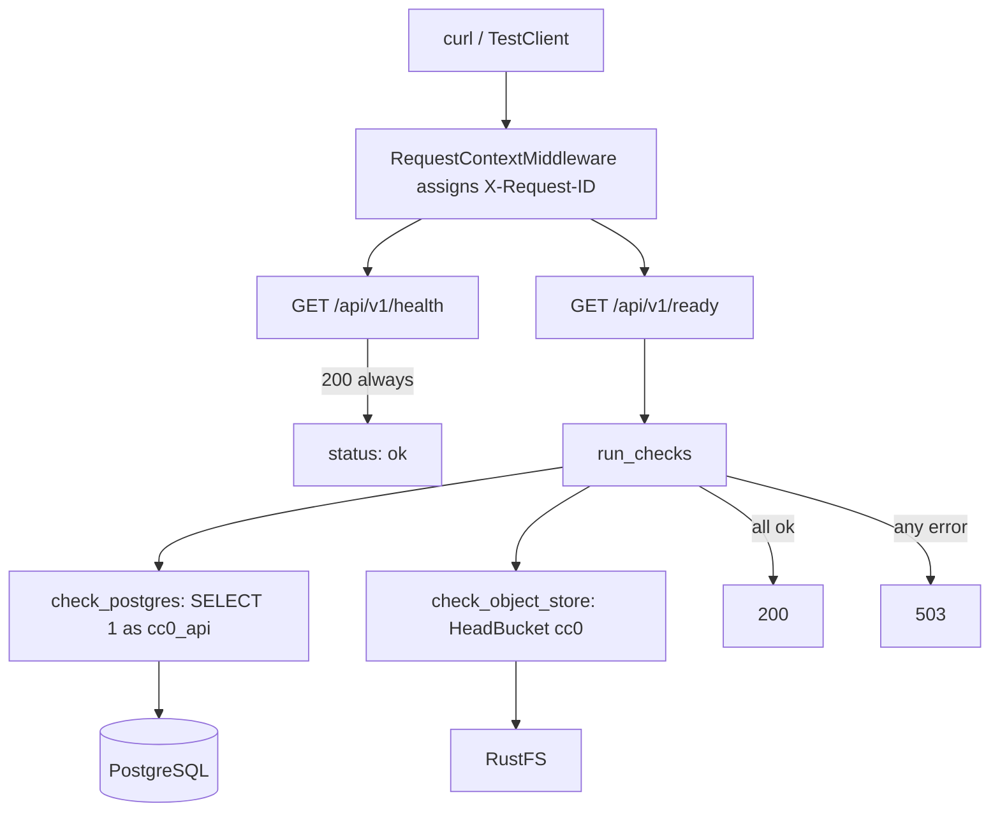

# API process

Status: Implemented (health and readiness only)
Owner: [backend/app/](../../backend/app/main.py)
Depends on: PostgreSQL, RustFS
Related: [storage.md](storage.md), [ADR-0003](../decisions/0003-database-roles.md), [ADR-0004](../decisions/0004-host-processes.md)

## Summary

A FastAPI application with two routes under `/api/v1`: a liveness check that
answers from the process alone, and a readiness check that proves Postgres and
the object store are both reachable with the credentials the application will
actually use. Middleware attaches a request id to every response and logs one
line per request. There are no catalog, search, or board routes yet.

## Architecture

## Important invariants

- `GET /api/v1/health` returns `200 {"status": "ok"}` whenever the process is
  up. It opens no connections, so a load balancer cannot confuse a degraded
  dependency with a dead process.
- `GET /api/v1/ready` is `200` only when both checks pass, and `503` otherwise.
  The body always carries both keys: `{"status": ..., "checks": {"postgres":
  "ok"|"error", "object_store": "ok"|"error"}}`.
- Readiness runs every check even after one fails, so a single response shows
  which dependencies are down rather than only the first.
- The Postgres check connects as `cc0_api` through `DATABASE_URL`, not as the
  superuser. Readiness therefore exercises the privileges the API really has.
- The object store check is a path-style `HeadBucket` on the configured bucket,
  signed with `s3v4` and `max_attempts: 1`, so the endpoint, credentials, and
  bucket name are all verified without retry delay.
- Responses expose no credentials, URLs, or driver text. `run_checks` collapses
  every failure to the string `error`, and even in logs the detail is reduced to
  an exception class name, with a further guard that discards anything that is
  not a bare identifier.
- Every response carries `X-Request-ID`. An inbound `x-request-id` header is
  reused; otherwise a UUID4 is generated.
- Request logs record method, path, status, and request id. Query strings,
  headers, tokens, and signed URLs are never logged, and botocore, boto3, and
  urllib3 are pinned to `WARNING` because botocore logs signed request details
  at `DEBUG`.
- Settings come from the environment or the repository-root `.env`, with
  `extra="ignore"` so Compose-only variables such as `POSTGRES_USER` do not
  break startup. `get_settings` is cached, and `create_app` accepts an explicit
  `Settings` so tests can pass their own.
- Dependency timeouts default to 2 seconds (`READINESS_TIMEOUT_SECONDS`) and
  apply to the Postgres connect, and the object store connect and read.

## Failure handling

- A dependency failure is a `503` with structured per-check results, not an
  exception reaching the client. `DependencyUnavailable` is raised inside each
  check and caught by `run_checks`.
- `run_checks` also catches unexpected exception types, not only
  `DependencyUnavailable`, so a misconfigured client cannot turn a readiness
  probe into a `500`.
- An unhandled exception anywhere in the request is logged with the request id
  and re-raised, so the traceback is correlatable without altering the response
  contract.
- Timeouts bound every readiness probe, so an unreachable host fails fast
  instead of hanging the check.
- The integration test asserts the full ready body against a live stack rather
  than only the status code, which catches a check silently reporting `ok` while
  doing nothing.

## Design decisions

- The API, the future worker, and the frontend run on the host against Compose
  data services, and are not containerized yet: [ADR-0004](../decisions/0004-host-processes.md).
- Readiness uses the restricted `cc0_api` login so the check fails when
  privileges are wrong: [ADR-0003](../decisions/0003-database-roles.md).
- The object store is reached through the S3 API so the same code path works
  against RustFS locally and S3 later: [ADR-0001](../decisions/0001-object-storage.md).
