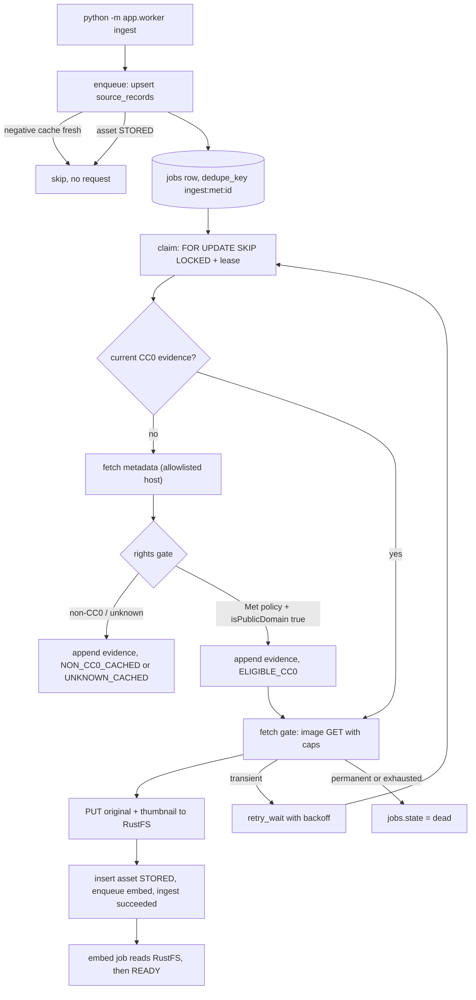

# Ingestion

Status: Implemented (M1: one provider, fixture-replayed by default)
Owner: [backend/app/ingestion/](../../backend/app/ingestion/service.py), [backend/app/worker/](../../backend/app/worker/runtime.py), [migration 0003](../../backend/migrations/versions/0003_catalog.py)
Depends on: PostgreSQL, RustFS
Related: [storage.md](storage.md), [api.md](api.md), [ADR-0003](../decisions/0003-database-roles.md), [ADR-0004](../decisions/0004-host-processes.md), [MVP spec M1](../mvp-spec.md#milestone-m1--ingestion-and-provenance-vertical-slice)

## Summary

A single worker process turns The Met Open Access records into stored CC0
assets, with an append-only record of why each one was allowed. Two gates run
in order. The rights gate reads item metadata and decides whether the item is
explicitly CC0; anything else becomes a metadata-only negative cache row and
nothing else happens. Only after CC0 evidence is written does the fetch gate
request image bytes, under a host allowlist and hard limits. A stored asset
stops at `STORED` (original, thumbnail, SHA-256, evidence). A separate `embed`
job sets `READY` after the vector commits. Public search reads
`ready_assets`: status `READY` and the latest evidence row verified CC0. See
[search](search.md).

Tests and the default local run replay recorded fixtures from
[backend/fixtures/met](../../backend/fixtures/met) and open no socket.

## Architecture



| Module | Responsibility |
|---|---|
| [met.py](../../backend/app/ingestion/met.py) | Catalog discovery, metadata allowlist, normalization and validation |
| [rights.py](../../backend/app/ingestion/rights.py) | The rights gate. Pure, no I/O |
| [fetch.py](../../backend/app/ingestion/fetch.py) | URL validation, public-address check, image and metadata HTTP clients, pacing |
| [images.py](../../backend/app/ingestion/images.py) | Bounded decode, SHA-256, WebP thumbnail |
| [fixtures.py](../../backend/app/ingestion/fixtures.py) | Recorded responses with the same allowlist rules, plus a request log |
| [service.py](../../backend/app/ingestion/service.py) | Discovery, enqueue/skip decisions, rights/fetch sequencing and durable workflow resume |
| [repository.py](../../backend/app/ingestion/repository.py) | Connection scopes, typed row mapping, atomic catalog and job writes |
| [queries.py](../../backend/app/ingestion/queries.py) | Parameterized SQL and pure JSON parameter builders; no I/O |
| [models.py](../../backend/app/ingestion/models.py) | SourceRecord, Asset, Evidence, and IngestOutcome dataclasses; no HTTP or driver types |
| [worker/ingest.py](../../backend/app/worker/ingest.py) | Drain/claim loop, lease lifecycle, retries, exhaustion and failure settlement |
| [worker/jobs.py](../../backend/app/worker/jobs.py) | Claim, lease, retry, dead letter, redrive |
| [worker/lease.py](../../backend/app/worker/lease.py) | Background claim renewal and deadline checks |
| [worker/runtime.py](../../backend/app/worker/runtime.py) | Injects the shared worker engine, job store, provider clients and object store |
| [embeddings/repository.py](../../backend/app/embeddings/repository.py) | Embedding persistence and claim-fenced publication |

### Layers and transaction boundaries

Following [ADR-0005](../decisions/0005-feature-based-layered-architecture.md),
the worker CLI drains `IngestWorker`, which invokes `IngestService` for the
business workflow. The service uses the concrete
`IngestionRepository`, which executes feature-local query builders. Rights,
metadata normalization, and image processing stay in focused modules. Services
also coordinate external clients and use the shared `JobStore` for feature-driven
enqueue/recheck decisions and durable progress hints; repositories never
call those clients. `models.py` uses the shared catalog vocabulary, which has no
infrastructure dependencies.

`build_runtime()` supplies `IngestionRepository(engine)` using the existing
worker pool. Construction opens no connection. Every repository operation owns
its connection scope and returns dataclasses or scalar results. Metadata/image
HTTP, image processing, object HEADs, and both object PUTs occur between catalog
operations, outside their connections. Lease renewal uses a separate short
connection as before.

Atomic writes retain their original boundaries:

- `record_rights_decision()` locks the current claim, updates source metadata
  and the database-clock recheck deadline, appends evidence, and applies any
  suppression in one transaction. It commits before an image request.
- `record_superseding_rights()` appends evidence and suppresses an asset in one
  transaction when the decision is not verified CC0.
- `store_asset()` locks the current claim, upserts the creator, inserts the
  asset, enqueues its model-scoped embed job, and settles ingestion success in
  one transaction. A duplicate asset still settles ingestion without another
  embed enqueue. Any failure rolls back the whole operation.

The shared `worker.jobs.hold_claim(connection, job)` receives that transaction's
connection. Its token, state, unexpired-lease predicate and `FOR UPDATE` lock
prevent a stale attempt from writing. It must not be replaced with a separate
committing job-store call. Other job claims, backoff, rechecks, redrive and
exhaustion reconciliation remain in `JobStore`.

### Worker execution ownership

`worker/ingest.py` owns `drain()`, `run_claimed()`, `LeaseKeeper`, retry/backoff,
attempt exhaustion and infrastructure settlement. `IngestService.execute()`
retains cache/evidence decisions, rights validation, fetch and object-write
sequencing, durable object reuse, and repository coordination. It receives a
`check_active` callback from the adapter; it neither creates nor renews a lease.
Checks run at the same points as before, including streamed image reads.

The runtime exposes `ingest_worker` and `embed_worker` alongside feature services,
using the same engine, pool and job store. Feature services no longer expose
`drain()` or `run_claimed()`. Claim-loss result constants live in worker adapters.
The claimed job still crosses into repositories for connection-scoped fencing.
`job_settled` tells the adapter when repository success was committed atomically;
it must not issue another success write. Unexpected exceptions still propagate,
leaving the lease to expire. No transaction or execution semantics change.

### Internal interface migration

`app.worker.ingest.IngestService` moved to `app.ingestion.service.IngestService`;
its constructor now takes `repository=IngestionRepository(engine)` instead of
`catalog_store=`. `IngestOutcome` moved to `app.ingestion.models`. Ingestion
catalog methods and their models moved from `worker.store` into the ingestion
repository and models. Embedding persistence now lives in
`app.embeddings.repository.EmbeddingRepository`. The private
`worker.store._hold_claim` helper is shared as `worker.jobs.hold_claim`.
Runtime, CLI and integration callers use the new imports. Operator commands,
result tokens, rights rules, SQL semantics, pools and schemas are unchanged;
there are no intentional behavior changes.

## What a row means

- `source_records` is the provider's item, unique on `(provider_id, external_id)`.
  It is also the negative cache: classification, eligibility, `next_recheck_at`,
  and allowlisted `raw_metadata` (object id, title, artist, dates, landing URL,
  image URL string, rights fields). Data URIs and the rest of the payload are
  dropped.
- `rights_evidence` is an append-only observation. A recheck inserts a row; no
  code path updates or deletes one. `raw_statement` keeps the provider's own
  text, and `decision_reason` stores the stable token for why the gate decided
  what it did. Evidence attaches to the source record even when no asset ever
  exists.
- `assets` is bytes we actually stored, unique on `source_record_id`. `sha256` is
  indexed but deliberately not unique.
- `jobs` is the lock and the retry ledger, not the audit log. `claim_token` is
  issued on each claim and required on every later write.
- `creators` are provider-scoped: the Met artist authority URL when present,
  otherwise a name key. No cross-provider person merge.

## Important invariants

- No image request happens before CC0 evidence is committed for that record.
  Non-CC0 and unknown records produce no asset row, no image GET, no object
  write, and no embedding row. An embed job is inserted only with the asset.
- The only passing claim for the Met is its published Open Access policy plus
  `isPublicDomain: true` (a JSON boolean; a non-boolean is rejected metadata).
  That flag is trusted only because the policy says the hosted image is CC0.
  `decide()` defaults to fail closed, so a later source cannot inherit the
  exception. Without the trusted flag, only an explicit CC0 dedication in the
  item's own statement admits a record.
- Public domain is not CC0. A public-domain mark is `PUBLIC_DOMAIN_MARK` and
  `NON_CC0_CACHED`; those bytes are never fetched. An expired copyright is a
  country-specific conclusion, and a photograph of the work can still be
  copyrighted. CC0 is a waiver from a rights holder.
- A restrictive statement beats the flag: other Creative Commons licenses and
  their URLs, a public-domain mark, copyright, permission, and personal-use
  language. That is `NON_CC0_CACHED`. A statement that both dedicates the work
  to CC0 and restricts it is `UNKNOWN_CACHED`. Empty or unrecognized text may
  pass only together with the trusted flag. The original statement is kept.
- Invalid or missing metadata is `UNKNOWN_CACHED`. Unknown rechecks after
  `INGEST_RECHECK_UNKNOWN_DAYS` (7), firm non-CC0 after
  `INGEST_RECHECK_NON_CC0_DAYS` (30). The deadline uses the database clock. Before
  it passes, enqueue returns without any HTTP call, metadata included.
- A fetch failure never rewrites eligibility. An `ELIGIBLE_CC0` record whose
  image is refused or unreachable keeps its evidence and has no asset; only the
  job dies.
- The fetch gate allows `https` only, no URL credentials, hosts in
  `INGEST_IMAGE_HOSTS` only (metadata uses the separate `INGEST_METADATA_HOSTS`),
  and refuses loopback, private, link-local, reserved, multicast, and
  unspecified addresses. Redirects are followed manually, at most
  `INGEST_MAX_REDIRECTS`, and every hop is re-validated and re-resolved.
- Bodies are streamed and counted against `INGEST_MAX_IMAGE_BYTES` (10 MB)
  whatever `Content-Length` says. Only JPEG, PNG, and WebP are decoded, and the
  pixel count is checked from the header before pixels load.
- Object keys are content-addressed:
  `originals/ab/cd/<sha256>.<ext>` and `thumbnails/ab/cd/<sha256>.webp`. The
  digest is also written as object metadata. The worker never deletes an object.
- The asset row is inserted only after both object PUTs succeed, in the same
  transaction that marks it `STORED`, enqueues the embed job, and marks the
  ingest job `succeeded`.
- A record that already has bytes (`STORED`, `READY`, or `SUPPRESSED`) is not
  sent back through the rights gate. `IngestionRepository.record_superseding_rights`
  appends a later decision and, when that decision is not verified CC0, sets
  the asset `SUPPRESSED` in the same transaction. Public queries use the latest
  evidence row and the status together. See [search](search.md).
- One claimed job at a time per worker, so one in-flight source request. In
  network mode a shared `Pacer` spaces metadata and image requests at
  `INGEST_RATE_LIMIT_RPS`.

## Jobs, retries, and the dead letter

PostgreSQL is the only job store. "Dead letter" is `jobs.state = dead` on the
same row, with `last_error` and `dead_at`, so the failure stays joined to its
source record and evidence. A later SQS or ElasticMQ queue would only wake the
worker; it would not hold a second copy of job state. See the spec's
[architecture notes](../mvp-spec.md) on not running two authoritative job
stores.

States: `pending`, `leased`, `retry_wait`, `succeeded`, `dead`.

- `dedupe_key = ingest:{provider}:{external_id}`, unique. A repeat ingest finds
  the existing row instead of queueing a second one.
- Claim is one `UPDATE` over a `FOR UPDATE SKIP LOCKED` candidate. It sets
  `leased_until`, issues a new `claim_token`, and increments `attempt_count` at
  claim time, so a worker killed mid-job still spends an attempt when its lease
  expires. A reclaim issues a different token. Every later write
  (`succeed`, `retry_later`, `mark_dead`, payload hints, lease renewal, and the
  catalog writes for a rights decision or an asset) matches that token, the
  leased state, and an unexpired lease. Zero rows means the claim was lost, and
  the stale worker does not record a terminal state. A background renewal
  extends the lease while the token is still held, and stops at
  `INGEST_JOB_DEADLINE_SECONDS` (900) so a stalled transfer cannot hold the job
  forever.
- `INGEST_MAX_ATTEMPTS = 4`: one attempt plus three retries.
- Transient (timeout, connection error, DNS failure, 429, 5xx, object store
  unavailable) goes to `retry_wait` with exponential backoff and jitter,
  honoring a numeric `Retry-After`.
- Permanent (other 4xx, allowlist or private-address refusal, non-image body,
  oversize, empty body, missing image URL) goes `dead` immediately without
  spending the transient budget.
- A lease that expires on the last attempt is settled by `reap_exhausted` at
  the start of each drain, because the claim query can no longer see it. If the
  asset already has bytes (`STORED`, `READY`, or `SUPPRESSED`), the job is
  reconciled as `succeeded`. An exhausted embed job is reconciled as
  `succeeded` when its vector row exists, and `dead` otherwise. A missing asset
  moves the ingest job to `dead` with `attempts_exhausted`.
- A repeat ingest never clears `dead`, never steals a live lease, and never
  resets `pending` or `retry_wait`. Those rows keep the attempts and the
  `next_run_at` they already have. A due negative-cache recheck resets attempts
  on a `succeeded` row only, and that condition is checked in the same
  statement as the reset.
- `redrive` is the operator action: `dead` back to `pending` with attempts reset.
  `last_error` is kept.

`jobs.kind` is the unit of independent retry. `ingest` downloads.
`embed:{model_key}:{model_version}:{asset_id}` encodes, with its own attempt
budget, so a model failure cannot re-lease the image download. The identity
in that key is the loaded provider's: OpenCLIP uses `MODEL_KEY` and
`MODEL_VERSION`, and the fake provider uses `fake` / `deterministic-v1`. The
embed row is inserted in the same transaction as the asset. An embed claim
matches payload `model_key` and `model_version` to that loaded identity.
Ingest claims are not filtered by model.

## Resume without a second download

There is no stage column. Progress is read from durable state on every attempt:

- Fresh negative cache: return, no request.
- Asset already has bytes (`STORED`, `READY`, or `SUPPRESSED`): mark the job
  succeeded and do not download again.
- `ELIGIBLE_CC0` with verified CC0 evidence and no recheck due: skip the
  metadata request and rebuild asset fields from stored `raw_metadata`.
- After both PUTs the job payload records `stored` (digest, keys, type,
  dimensions). A later attempt heads both keys and compares the stored digest;
  a match skips the image GET and commits the asset (`stored_from_existing_objects`).
  A missing or mismatched object downloads again.

`payload.last_step` (`rights_check`, `download`, `store`) is an operator hint
only; skip logic never trusts it.

## Operator commands

Run from `backend/`, with the stack up and migrations applied:

```bash
.venv/bin/python -m app.worker ingest                 # discover, queue, ingest, embed
.venv/bin/python -m app.worker ingest --object-id 100001
.venv/bin/python -m app.worker drain                  # queued ingest, then embed
.venv/bin/python -m app.worker reembed                # assets missing the active model
.venv/bin/python -m app.worker jobs --state dead      # inspect dead letters
.venv/bin/python -m app.worker redrive --dedupe-key ingest:met:400001
.venv/bin/python -m app.worker redrive --all-dead
```

`ingest` and `drain` exit 1 when any job in the batch went `dead`. Against the
recorded catalog a first run stores 10 assets, negative-caches 6 records, and
dead-letters 3 eligible records whose images are refused by design (missing
image URL, off-allowlist host, HTML body). A second run makes no requests.

`INGEST_SOURCE_MODE=network` switches to the live Met API. It is opt-in and
never used by tests. Regenerate fixtures with
`backend/.venv/bin/python backend/scripts/make_fixtures.py`; the JSON is
hand-written Met-shaped data and the images are generated solids, not provider
bytes.

## Failure handling

- Every failure is classified as `TransientFailure` or `PermanentFailure` with a
  short stable `reason` token, which is what lands in `jobs.last_error` and the
  logs. Exception messages, URLs with query strings, and bodies are not stored.
- A crash between the PUTs and the asset commit leaves objects with no asset
  row. The lease expires, the next attempt verifies and reuses those objects,
  and only then does an asset appear. If the job dies instead, the objects stay
  unreferenced; M1 does not garbage-collect them.
- A crash before the payload hint is written re-downloads once under the attempt
  cap. The content-addressed PUT overwrites identical bytes.

## Design decisions

- One provider whose policy defines the item flag, not a general public-domain
  heuristic. Ordinary public-domain status is not CC0 for this product.
- Duplicate works across sources are out of scope. Identical bytes under two
  source records share an object key and keep two asset rows, each with its own
  evidence. A later cross-source match is a relation between assets, not a merge.
- Separate per-process pools: the worker uses `WORKER_DATABASE_URL` (2 + 2
  overflow) and never borrows the API engine ([ADR-0004](../decisions/0004-host-processes.md)).

## Known limitations

- The public-address check resolves DNS separately from the HTTP client's own
  connection, so a DNS rebinding answer between the two is not caught. Network
  mode is opt-in and the image host allowlist still applies. Pinning the
  connection to the checked address is future work.
- The `Pacer` spaces requests within one process. Replicas would need a shared
  token bucket.
- An HTTP-date `Retry-After` falls back to computed backoff.

## Refactor validation

The interrupted ingestion extraction has been reviewed against the original
service and persistence code. Focused unit tests cover orchestration ordering,
negative-cache and stored-asset skips, evidence/object reuse, object-store
failure, retries, and lost claims. Repository tests exercise connection release,
claim fencing, and rollback at each write in the atomic operations; query tests
check bound values, JSON payloads, ordering and database-clock deadlines.
Existing ingestion and search integration scenarios remain in place with their
internal imports updated. Added real-database failure tests verify that an
evidence insert failure rolls back the source decision before any image fetch,
and that failures at embed enqueue or ingest success roll back the creator,
asset, embed job and success together. After lease expiry, the latter tests
verify that retries reuse the surviving objects without another download.

Validation on 2026-10-16:

- `backend/.venv/bin/ruff check backend`: passed.
- `backend/.venv/bin/pytest backend/tests/unit`: 175 passed.
- `backend/.venv/bin/pytest backend/tests/integration`: 37 passed against real
  PostgreSQL/pgvector and RustFS, with fixture provider responses.
- `git diff --check`: passed. Extracted SQL constants match the original SQL
  after whitespace normalization.

The initial RustFS blocker was resolved by starting Docker Desktop and the
repository's existing Compose RustFS service and bucket initializer. The server
already on port 5432 rejected this project's credentials, so validation used the
Compose Postgres service on port 55432 with existing migrations applied.
`MIGRATION_DATABASE_URL`, `DATABASE_URL`, and `WORKER_DATABASE_URL` were overridden
for the validation processes to use that port; the existing server and `.env`
were left unchanged. On WSL with the Windows Docker CLI, the launch command was
`WSLENV=POSTGRES_PORT POSTGRES_PORT=55432 docker.exe compose up -d --wait postgres`.
Normal stack commands are in [lint and tests](../lint-test.md#checks-that-need-the-local-data-services).

Ingestion refactor validation is complete, with no remaining blockers or
intentional behavior changes. Both suites emit the existing Starlette/AnyIO
`BlockingPortal` deprecation warning.

### Worker ownership correction validation

The execution/workflow split preserves the feature layers introduced above.
Validation on 2026-10-16: Ruff passed, all 209 unit tests and 41 integration tests
passed, and `git diff --check` passed. Integration coverage retains real-database
rollback, stale-worker fencing, retry/resume, and atomic settlement scenarios.
The existing Starlette/AnyIO deprecation warning remains. No schemas, grants,
repository transactions, shared job mechanics, or pool lifecycles changed.
