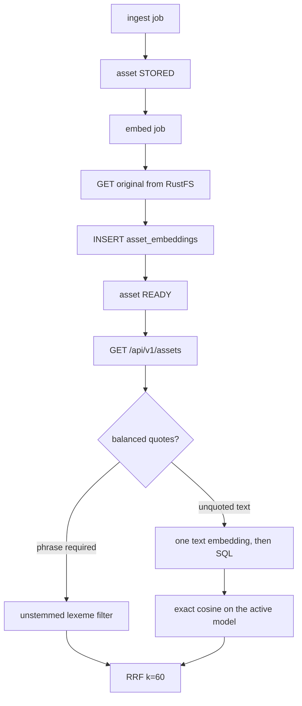

# Search and embeddings

Status: Implemented (M2: default fake provider, OpenCLIP optional and unpinned)
Owner: [backend/app/embeddings/](../../backend/app/embeddings/provider.py), [backend/app/search/](../../backend/app/search/service.py), [backend/app/worker/embed.py](../../backend/app/worker/embed.py), [migration 0006](../../backend/migrations/versions/0006_embeddings.py)
Depends on: PostgreSQL pgvector, RustFS, the M1 catalog
Related: [ingestion.md](ingestion.md), [storage.md](storage.md), [api.md](api.md), [ADR-0002](../decisions/0002-postgres-pgvector.md), [MVP spec M2](../mvp-spec.md#milestone-m2--image-embeddings-and-hybrid-search)

## Summary

Ingest stops at `STORED`. A separate `embed` job reads the original from
RustFS, inserts one vector for the loaded provider's identity, and sets the
asset `READY`. Public search, detail, and related read `ready_assets`: status
`READY` and the latest rights evidence row is verified CC0. Non-CC0 and unknown
records still get no asset, no object, and no vector.

The column is `vector(512)`, the width of the ViT-B family. OpenCLIP's identity
is `MODEL_KEY` and `MODEL_VERSION`. `MODEL_VERSION=unpinned` does not download
weights. The fake provider's identity is `fake` / `deterministic-v1`,
independent of those two settings. CI and the default local provider are that
fake. Real OpenCLIP is an optional extra and a manual command.

Query text is encoded for that request and dropped. It is not a row in
`asset_embeddings`.

## Architecture



| Module | Responsibility |
|---|---|
| [provider.py](../../backend/app/embeddings/provider.py) | Contract, fake provider, L2 normalization |
| [openclip.py](../../backend/app/embeddings/openclip.py) | Optional loader. Imported only when `EMBEDDING_PROVIDER=openclip` |
| [worker/embed.py](../../backend/app/worker/embed.py) | Claim, read the original, insert the vector, publish |
| [search/parse.py](../../backend/app/search/parse.py) | Balanced phrases and stripped stray quotes |
| [search/rank.py](../../backend/app/search/rank.py) | Reciprocal rank fusion |
| [search/service.py](../../backend/app/search/service.py) | Filters, lexical rank, cosine, provenance view |

## What a row means

- `asset_embeddings` is one vector per `(asset_id, model_key, model_version)`.
  The worker may insert. It may not update or delete. A new checkpoint is a new
  row. Search reads the identity of the provider the API process loaded.
  OpenCLIP uses `MODEL_KEY` and `MODEL_VERSION`. The fake provider stores
  `fake` / `deterministic-v1`, so a fake row is a different index from an
  OpenCLIP checkpoint of the same environment names. Pointing the API at an
  older identity restores that ranking. Rows for the previous identity stay.
- `assets.lexeme_simple` is the `simple` dictionary: creator name and aliases
  at weight A, title and tags at B, description at C. A name like Running stays
  `running`. Quoted phrases match this vector only, so a quote does not stem.
- `assets.lexeme_english` is the `english` dictionary on title, tags, and
  description. Unquoted lexical rank is `ts_rank_cd` on both vectors.
- `ready_assets` picks the latest `rights_evidence` row for the source record
  (`checked_at DESC, id DESC`) and keeps the asset when that row is
  `rights_type` CC0, `verification_status` VERIFIED, and `assets.status` is
  READY. Browse, ranked search, related candidates, and asset detail all read
  the view. `cc0_api` selects the view and has no privilege on `source_records`
  or `rights_evidence`. The view owner is the migration superuser
  (`security_invoker = false`).
- A newer evidence row that is not verified CC0 is written by
  `CatalogStore.record_superseding_rights`, which sets the asset `SUPPRESSED`
  in that same transaction. Ingest treats an asset that already has bytes as
  finished and does not re-run the rights gate, so this function is how a
  published asset is unpublished. Public queries require both gates. A
  suppression or a latest decision that is not verified CC0 removes the asset
  from search, detail, and related. Detail is 404.
- `pg_trgm` suggests a creator name. It fixes a typo such as `Vincent van Goh`
  toward `Vincent van Gogh`. It does not expand `DaVinci` into `Leonardo da
  Vinci`, and it does not rerank assets.

## Search

`GET /api/v1/assets` takes `q`, `creator_id`, `location`, `year_from`,
`year_to`, `limit` (1–50, default 20), and `cursor`.

- No `q`: newest public assets. No embedding call. Cursor is a keyset on
  `(ingested_at, id)`.
- Balanced `"..." ` spans are required phrases. A query that is only quotes
  ranks by the lexical score and does not encode text.
- Mixed text (`"da vinci" coastal`) keeps the phrase as a filter and fuses the
  unquoted remainder.
- An unpaired quote is removed. `applied_query` is what was searched, so a
  client can show “Searching for …”.
- Unquoted text embeds once, off the event loop (the route is synchronous),
  and before a catalog connection is checked out. Each provider runs one encode
  at a time. Lexical and cosine lists are capped at 50 and fused with `k = 60`.
  The fused order is at most 100 ids, and a quotes-only query stores at most
  50. That list is the whole ranked result for the request.
- Creator, location, and year are SQL predicates. Location is exact. A year
  filter excludes assets with no year.
- An empty quoted phrase returns no assets. An unquoted string that matches no
  words still has nearest neighbors.
- When the first page is empty, `suggestion` may be a similar creator name.

`GET /api/v1/assets/{id}` reads `ready_assets`. A `STORED` asset, a
`SUPPRESSED` asset, and a `READY` asset whose latest evidence is not verified
CC0 are 404.
`GET /api/v1/assets/{id}/related` is exact cosine order of the active model
among other rows of that same view, excluding the seed. `reasons` may include
`same_creator`, `same_location`, and `same_style_tag`. There is no HNSW index
and no `asset_relations` table.

A ranked cursor is bound to the applied query, its phrases and unquoted text,
`creator_id`, `location`, `year_from`, `year_to`, and the active embedding
identity (`model_key`, `model_version`). A cursor for a different query, filter
set, or model is HTTP 400. The first page stores the fused id order. Later
pages return the next slice of that snapshot. Loading a card reads
`ready_assets` again, so a suppressed id is left out and the ids after it keep
the positions from the first page. An asset that becomes public after the first
page appears on a new search. The snapshot cap above is the product limit for
one ranked query.
`GET /api/v1/creators?query=` lists creators and sets `did_you_mean` when the
closest name is not the typed string.

## Embed job

`dedupe_key = embed:{model_key}:{model_version}:{asset_id}` uses the provider
identity. Ingest inserts that row in the same transaction as the asset. The
worker reads `original_key` from object storage. A timeout or client error
while reading the body is `ObjectStoreUnavailable`, the body is closed, and
the embed job retries. If the vector row already exists, inference is skipped
and a `STORED` asset still moves to `READY`. A dead embed job leaves the asset
`STORED`.

An embed worker claims jobs whose payload `model_key` and `model_version`
match the loaded identity. That filter is inside the `FOR UPDATE SKIP LOCKED`
candidate query. A job for another checkpoint stays pending, `retry_wait`, or
leased by its owner, and this worker does not spend its attempts. Ingest
claims are not filtered by model.

`python -m app.worker reembed` finds `STORED` or `READY` assets missing the
loaded identity, queues them, redrives dead embed jobs for that identity, and
drains. A second run does not insert a second vector. Fake rows stay when you
later load OpenCLIP: `enqueue_missing` for the OpenCLIP identity still queues
those assets, and nothing deletes or updates the fake rows.

## Changing the checkpoint

Rebuild with the worker on the new checkpoint while `MODEL_KEY` and
`MODEL_VERSION` match that provider identity:

```bash
.venv/bin/python -m app.worker reembed
```

Confirm coverage: every asset that passes the `ready_assets` predicate has a
row in `asset_embeddings` for that identity. Then start the API so its process
loads the same identity. Environment config alone leaves a running API on the
identity it already loaded. Old rows stay, so starting the API on the previous
identity is the rollback.

## Operator commands

```bash
.venv/bin/python -m app.worker ingest     # ingest, then embed
.venv/bin/python -m app.worker drain      # queued ingest jobs, then embed jobs
.venv/bin/python -m app.worker reembed    # assets missing the active checkpoint
.venv/bin/python -m app.embeddings        # manual OpenCLIP order check
```

The smoke command requires `EMBEDDING_PROVIDER=openclip`, a real
`MODEL_VERSION`, and `pip install -e "backend[embeddings]"`. It prints two
cosines and fails when the related pair does not rank ahead. CI does not run it.

## Later

A process-local LRU for query vectors, keyed by model version plus the
normalized string, is the first cache if repeated queries show text encode in
search latency. Redis stays the later step for more than one API process.
A ranked page is the snapshot stored in its cursor. Search quality benchmarks
stay in milestone M4.
