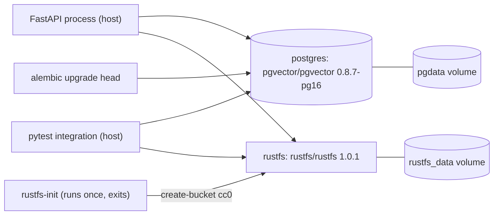

# Storage

Status: Implemented (foundation only)
Owner: [docker-compose.yml](../../docker-compose.yml), [docker/postgres/init/](../../docker/postgres/init/01-vector.sql), [backend/migrations/](../../backend/migrations/versions/0001_enable_vector_and_roles.py), [backend/app/db/](../../backend/app/db/roles.py)
Depends on: Docker Compose
Related: [api.md](api.md), [ADR-0001](../decisions/0001-object-storage.md), [ADR-0002](../decisions/0002-postgres-pgvector.md), [ADR-0003](../decisions/0003-database-roles.md)

## Summary

Two long-running local services hold state: PostgreSQL with the `vector`
extension for relational data and future embeddings, and RustFS as an
S3-compatible object store for future image bytes. A one-shot `rustfs-init`
container creates the `cc0` bucket. One Alembic revision enables `vector` and
creates the three login roles; there are no catalog tables yet, so nothing is
stored beyond `alembic_version`.

## Architecture

## Important invariants

- Host ports bind to `127.0.0.1` only: Postgres on `5432`, the RustFS S3 API on
  `9000`, the RustFS console on `9001`. Each is overridable through `.env`
  (`POSTGRES_PORT`, `RUSTFS_API_PORT`, `RUSTFS_CONSOLE_PORT`).
- S3 requests use path-style addressing. `rustfs-init` writes
  `addressing_style = path` into its AWS config before calling `create-bucket`,
  and the application clients pass `s3={"addressing_style": "path"}`.
- Bucket creation is idempotent. `rustfs-init` runs `head-bucket` first and
  exits 0 when `cc0` already exists, so a second run never creates a second
  bucket.
- The `vector` extension is enabled twice by design. `01-vector.sql` runs once
  per freshly created data volume, and the migration runs
  `CREATE EXTENSION IF NOT EXISTS vector` for the case where that init hook was
  skipped, such as an existing volume.
- Alembic connects as the Postgres superuser through `MIGRATION_DATABASE_URL`,
  because creating roles and extensions requires it. The three application
  logins are `LOGIN NOSUPERUSER NOCREATEDB NOCREATEROLE NOINHERIT`.
- `cc0_migrator` holds `USAGE, CREATE` on schema `public`. `cc0_api` and
  `cc0_worker` hold `USAGE` only and cannot create tables; the integration test
  asserts that `CREATE TABLE` raises `InsufficientPrivilege` for both.
- Roles are cluster-wide, not per-database. The migration test creates a
  throwaway database and monkeypatches suffixed role names so it never touches
  the real `cc0_api`, `cc0_migrator`, or `cc0_worker`.
- Identifiers are validated rather than escaped: `quote_identifier` rejects
  anything outside letters, digits, and underscores, and `ensure_login_sql`
  rejects passwords containing `$$` or a null byte, because the role SQL is a
  dollar-quoted `DO` block built as a plain string.
- Named volumes `pgdata` and `rustfs_data` survive `docker compose stop`. Only
  `docker compose down -v` deletes them.

## Failure handling

- Both services declare healthchecks, and `scripts/check.sh` starts them with
  `docker compose up -d --wait` so the migration never runs against a Postgres
  that is still initializing. RustFS gets a 15 second start period.
- `rustfs-init` runs as a separate `docker compose run --rm` step in the check
  script, so a bucket-creation failure becomes the script's exit code instead of
  being buried in Compose output.
- Integration tests fail rather than skip when a service is down. The
  `running_stack` fixture probes the TCP port first and reports host and port
  with the Compose command to run, so a stopped container does not look like bad
  credentials, a missing extension, or a missing bucket. It deliberately prints
  host and port only, since the database URL also carries a password.
- The migration has a working `downgrade`: it revokes schema privileges, revokes
  `CONNECT`, drops the three roles, and drops the extension. The test asserts a
  clean `upgrade` then `downgrade` round trip.
- A role that already exists is updated rather than failing. `ensure_login_sql`
  emits `CREATE ROLE` or `ALTER ROLE` depending on `pg_roles`, which makes
  re-running the migration on a cluster with leftover roles safe.

## Design decisions

- Image bytes belong in object storage, not in Postgres: [ADR-0001](../decisions/0001-object-storage.md).
- One database serves relational data and vectors: [ADR-0002](../decisions/0002-postgres-pgvector.md).
- Each component gets its own login before any catalog tables exist: [ADR-0003](../decisions/0003-database-roles.md).
- Compose runs data services only; application processes run on the host: [ADR-0004](../decisions/0004-host-processes.md).
