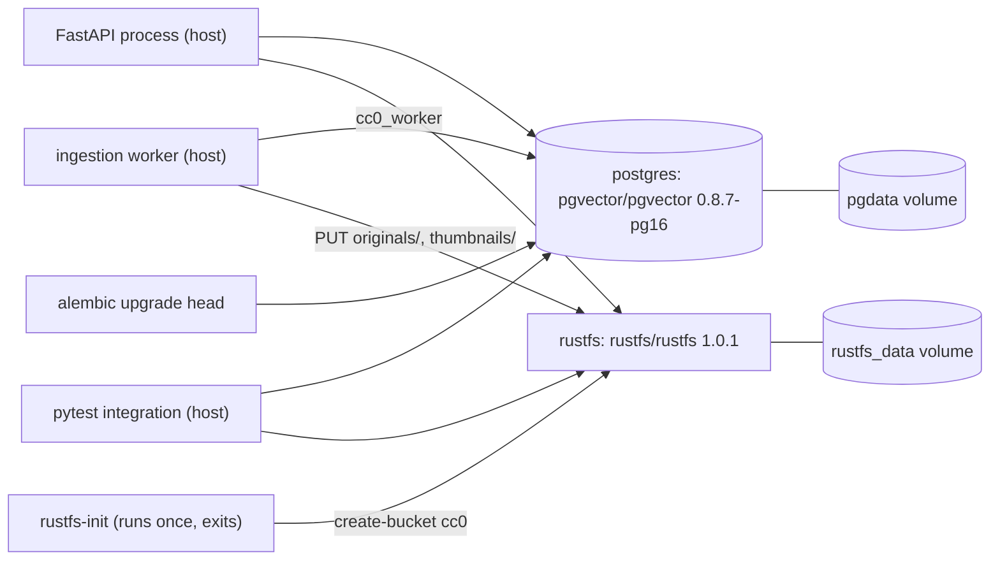

# Storage

Status: Implemented (foundation and M1 catalog)
Owner: [docker-compose.yml](../../docker-compose.yml), [docker/postgres/init/](../../docker/postgres/init/01-vector.sql), [backend/migrations/](../../backend/migrations/versions/0003_catalog.py), [backend/app/db/](../../backend/app/db/roles.py)
Depends on: Docker Compose
Related: [api.md](api.md), [ingestion.md](ingestion.md), [ADR-0001](../decisions/0001-object-storage.md), [ADR-0002](../decisions/0002-postgres-pgvector.md), [ADR-0003](../decisions/0003-database-roles.md)

## Summary

Two long-running local services hold state: PostgreSQL with the `vector`
extension for relational data and future embeddings, and RustFS as an
S3-compatible object store for image bytes. A one-shot `rustfs-init`
container creates the `cc0` bucket. Alembic revision 0001 enables `vector` and
creates the three login roles; 0002 granted broad default privileges for M0;
0003 revokes those defaults and creates the six ingestion catalog tables
(`providers`, `creators`, `source_records`, `rights_evidence`, `assets`, `jobs`)
with per-table grants. What those rows mean is in [ingestion](ingestion.md).
Embeddings, boards, exports, and users do not exist yet.

## Architecture

## Important invariants

- Host ports bind to `127.0.0.1` only: Postgres on `5432`, the RustFS S3 API on
  `9000`, the RustFS console on `9001`. Each is overridable through `.env`
  (`POSTGRES_PORT`, `RUSTFS_API_PORT`, `RUSTFS_CONSOLE_PORT`).
- S3 requests use path-style addressing. `rustfs-init` writes
  `addressing_style = path` into its AWS config before calling `create-bucket`,
  and the application clients pass `s3={"addressing_style": "path"}`.
- Bucket creation is idempotent. `rustfs-init` runs `head-bucket` first and
  exits 0 when `cc0` already exists, so a second run never creates a second
  bucket.
- The `vector` extension is enabled twice by design. `01-vector.sql` runs once
  per freshly created data volume, and the migration runs
  `CREATE EXTENSION IF NOT EXISTS vector` for the case where that init hook was
  skipped, such as an existing volume.
- Alembic connects as the Postgres superuser through `MIGRATION_DATABASE_URL`,
  because creating roles and extensions requires it. The three application
  logins are `LOGIN NOSUPERUSER NOCREATEDB NOCREATEROLE NOINHERIT`.
- `cc0_migrator` holds `USAGE, CREATE` on schema `public`. `cc0_api` and
  `cc0_worker` hold `USAGE` only and cannot create tables; the integration test
  asserts that `CREATE TABLE` raises `InsufficientPrivilege` for both.
- Roles are cluster-wide, not per-database. The migration test creates a
  throwaway database and monkeypatches suffixed role names so it never touches
  the real `cc0_api`, `cc0_migrator`, or `cc0_worker`.
- Identifiers are validated rather than escaped: `quote_identifier` rejects
  anything outside letters, digits, and underscores, and `ensure_login_sql`
  rejects passwords containing `$$` or a null byte, because the role SQL is a
  dollar-quoted `DO` block built as a plain string.
- Named volumes `pgdata` and `rustfs_data` survive `docker compose stop`. Only
  `docker compose down -v` deletes them.
- Catalog grants (revision 0003). `cc0_worker` has `SELECT, INSERT, UPDATE` on
  all six catalog tables and no `DELETE` anywhere, so dead jobs and rights
  evidence survive for inspection. `cc0_api` has `SELECT` on `creators` and
  `assets` only; it cannot see providers, source records, evidence, or jobs.
  Every primary key is a UUID from `gen_random_uuid()`, so there are no
  sequences to grant. The migration test checks each table and privilege with
  `has_table_privilege`.
- Catalog vocabulary lives in [app/db/catalog.py](../../backend/app/db/catalog.py)
  and becomes `CHECK` constraints in 0003, so an unknown status fails in the
  database rather than widening a column. Text plus `CHECK` instead of native
  enums keeps later additions to a constraint swap.
- Image objects are content-addressed: `originals/ab/cd/<sha256>.<ext>` and
  `thumbnails/ab/cd/<sha256>.webp`, with the digest also stored as object
  metadata `sha256`. The worker writes and heads objects and never deletes one.
- Integration tests never touch the operator's catalog or bucket. The catalog
  tests migrate a throwaway database per module, and each ingestion test writes
  to its own `cc0-test-*` bucket, removed at teardown. Sharing the real bucket
  would delete objects a local ingest run points at, because the fixture bytes
  and therefore the keys are identical.

## Failure handling

- Both services declare healthchecks, and `scripts/check.sh` starts them with
  `docker compose up -d --wait` so the migration never runs against a Postgres
  that is still initializing. RustFS gets a 15 second start period.
- `rustfs-init` runs as a separate `docker compose run --rm` step in the check
  script, so a bucket-creation failure becomes the script's exit code instead of
  being buried in Compose output.
- Integration tests fail rather than skip when a service is down. The
  `running_stack` fixture probes the TCP port first and reports host and port
  with the Compose command to run, so a stopped container does not look like bad
  credentials, a missing extension, or a missing bucket. It deliberately prints
  host and port only, since the database URL also carries a password.
- Downgrade is three revisions. 0003 revokes its table grants, drops the
  catalog tables, and re-applies the 0002 defaults so the next step still
  matches what it expects. 0002 revokes the default privileges it granted
  and does not revoke grants already applied to existing tables. 0001 then
  revokes schema privileges, revokes `CONNECT`, drops the three roles, and
  drops the extension. `alembic downgrade base` runs all three. The test asserts
  a clean `upgrade` then `downgrade` round trip.
- A role that already exists is not created again. `ensure_login_sql` emits
  `CREATE ROLE` or attribute-only `ALTER ROLE` depending on `pg_roles`.
  Re-executing 0001 preserves the password and still rewrites role attributes
  (`LOGIN NOSUPERUSER NOCREATEDB NOCREATEROLE NOINHERIT`). Because the password
  is not updated, readiness can fail until the operator aligns it with `.env`.
  `alembic downgrade base` drops the roles, so a later upgrade creates them
  again and sets the password from the environment. Changing `.env` alone does
  not rotate an existing cluster. Local rotation is a new volume, a manual
  `ALTER ROLE`, or downgrade to base plus upgrade.

## Design decisions

- Image bytes belong in object storage, not in Postgres: [ADR-0001](../decisions/0001-object-storage.md).
- One database serves relational data and vectors: [ADR-0002](../decisions/0002-postgres-pgvector.md).
- Each component gets its own login before any catalog tables exist: [ADR-0003](../decisions/0003-database-roles.md).
- Compose runs data services only; application processes run on the host: [ADR-0004](../decisions/0004-host-processes.md).

## Future objects and local identities

At head there are no default privileges for API or worker. 0003 revoked the
broad M0 defaults from 0002 before its first `CREATE TABLE`, so a new table
grants nothing until its own migration says so. Later revisions follow the
per-table matrix in the [M2 handoff](../m2-handoff.md#3-postgresql-permissions)
and add assertions to the migration test.
Shared RustFS keys are a development shortcut; production needs separate API,
worker, and bucket-init identities as described in [ADR-0001](../decisions/0001-object-storage.md).
See [local development](../local-development.md) for roles, grants, and rotation.
